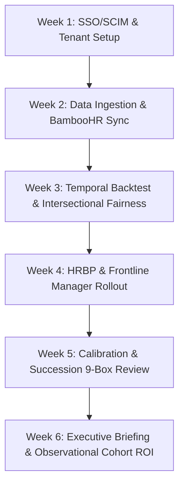

# CareerPath Intelligence — 6-Week Enterprise Pilot Rollout Plan

**Release Target:** v3.2.0 Enterprise Release  
**Methodology:** Structured, phased validation of workforce analytics, temporal backtesting, intersectional fairness, and talent retention workflows.

---

## 1. Pilot Objectives & Quantitative Verification Criteria

The 6-week pilot validates analytical precision, regulatory compliance, and operational utility within a target division (typically 500 to 2,500 employees).

### Quantitative Verification Targets:
1. **Temporal Backtest Validation:** Rolling-origin backtest on historical exits demonstrates positive Lift over Base Rate and superior calibration over naive heuristics.
2. **Intersectional Parity Verification:** All demographic slices (Gender × AgeBand, Gender × Department) audited with False Discovery Rate (FDR) Benjamini-Hochberg correction ($q \ge 0.05$) or documented in a formal bias review sign-off.
3. **Manager Alignment & Scoping:** 100% of frontline people managers access only direct reports with zero cross-team data leaks.
4. **Talent Committee Velocity:** Calibration session prep and decision latency reduced by 40%+ via automated candidate dossiers and pseudonymized presentation mode.

---

## 2. Weekly Pilot Milestone Schedule

### Week 1: SSO/SCIM Configuration, Workspace Provisioning & RBAC
- Configure Enterprise Single Sign-On (OIDC code flow with PKCE) and SCIM 2.0 provisioning (`/scim/v2/Users`).
- Provision isolated enterprise workspace (`workspace_id`) with role-based access control:
  - `admin`: IT / People Analytics Operations
  - `hr_analyst`: People Analytics Modeling & Model Registry
  - `hrbp`: Division HR Business Partners
  - `manager`: Frontline people leaders (team-scoped)
  - `talent_committee`: Executive calibration committee members
- Configure visual identity: brand logo mark, primary accent color, and custom domain mapping.

### Week 2: Workforce Ingestion, BambooHR Sync & Historical Exits
- Ingestion of primary workforce roster via CSV or live BambooHR Connector:
  - Core fields: `EmployeeID`, `JobLevel`, `JobRole`, `Department`, `YearsAtCompany`, `YearsInCurrentRole`, `YearsSinceLastPromotion`, `PerformanceRating`.
  - Enrichment fields: `TrainingTimesLastYear`, `JobSatisfaction`, `YearsWithCurrManager`.
- Ingestion of historical termination logs via **Bring-Your-Own (BYO) Historical Exits** flow (`POST /api/dataset/upload-exits`):
  - Fields: `employee_id`, `exit_date`, `exit_reason`.
- Automatic execution of data quality audit: null value handling, boundary validation, and zero-dwell imputation.

### Week 3: Temporal Backtesting, Intersectional Fairness & Bias Sign-Off
- Execute rolling-origin temporal backtesting across multiple historical origins, benchmarking Transparent RRI vs. Supervised HistGBDT vs. Naive Baseline.
- Run complete Intersectional Demographic Parity audit:
  - Evaluate Gender × AgeBand, Gender × Department, AgeBand × Department.
  - Apply sample size $n < 10$ suppression to protect privacy.
  - Compute Chi-Square / Fisher's Exact $p$-values and Benjamini-Hochberg adjusted $q$-values.
- Conduct formal **Bias Review Sign-Off** (`POST /api/fairness/signoff`) with written justification before promoting the model to active inference.

### Week 4: HRBP & Frontline People Manager Enablement
- Train HRBPs on the **Retention Opportunities** workspace and longitudinal **Trends & Tier Migration** tracking using standardized risk tiers (`Urgent`, `Moderate`, `Standard`).
- Deploy **My Team & 1-on-1s** workspace to frontline people managers:
  - Verify negative authorization barriers (non-team access strictly returns `HTTP 403 Forbidden`).
  - Equip managers with supportive 1-on-1 talking points, top 3 drivers, and developmental follow-up scheduling.
  - Enforce "Non-Punitive Diagnostic Decision Support" agreement prior to viewing score breakdowns.

### Week 5: Talent Committee Calibration & Succession 9-Box Review
- Conduct live talent calibration sessions using **Talent Committee Review**:
  - Activate Presentation Mode to evaluate candidates using pseudonymized identifiers (`CANDIDATE-9A4B`).
  - Calibrate employees across the 9-Box talent matrix.
  - Detect critical Single Points of Failure (SPOFs) in leadership and technical key roles.
- Record decisions (Approved, Deferred, Action Plan) with immutable audit logging.

### Week 6: Automated Executive Briefing & Observational Cohort ROI
- Generate automated **Executive Workforce Briefing** (`GET /api/briefings/executive`) with key metrics, critical departments, and talent interventions.
- Review Matched Observational Cohort analysis comparing before/after RRI against matched controls (with transparent selection bias caveats).
- Export complete compliance package from Trust Center:
  - NYC Local Law 144 Bias Audit Summary (CSV)
  - Pre-filled Data Protection Impact Assessment (`docs/DPIA_TEMPLATE.md`)
  - Formal Model Card (`docs/MODEL_CARD.md`)
- Present final evaluation to Chief People Officer and determine company-wide deployment plan.

---

## 3. Data Privacy & Enterprise Trust Commitments

1. **Zero External Data Leakage:** All computation executes within your secure tenant container or private VPC. No employee PII is sent to external commercial LLM APIs.
2. **Field-Level AES-256-GCM Encryption:** HRIS credentials and API tokens are encrypted at rest with PBKDF2 derived keys and random 96-bit nonces.
3. **Automated GDPR Compliance:** Instant Data Subject Access Request (DSAR) export (`GET /api/governance/data-subject-export/{id}`) and retention preview (`GET /api/governance/preview-retention`).
4. **Immediate Data Erasure:** Full workspace data and audit logs can be permanently sanitized upon pilot conclusion.
