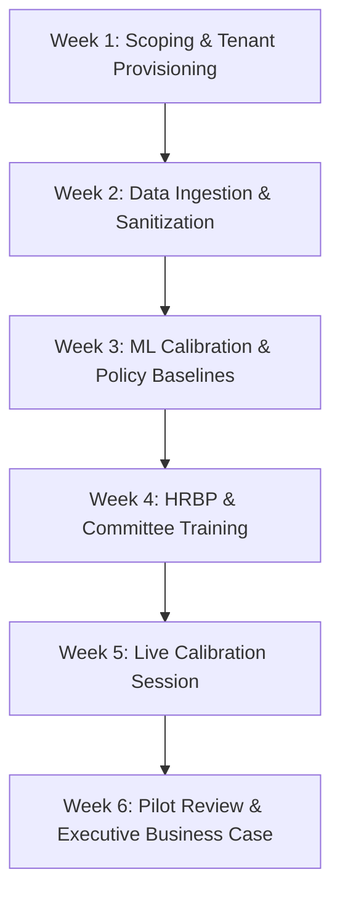

# CareerPath Intelligence — 4-6 Week Enterprise Pilot Rollout Plan

This document outlines the structured pilot deployment methodology for enterprise workforce analytics and retention intelligence.

---

## 1. Pilot Objectives & Success Criteria

The 30-to-45 day pilot aims to validate the analytical accuracy and business utility of CareerPath Intelligence within a single division or business unit (typically 500 to 2,500 employees).

### Quantitative Success Criteria:
1. **Model Calibration Accuracy:** Unsupervised clustering and dwell curves align with 90%+ of historical promotions recorded over the prior 24 months.
2. **Early Detection Reach:** Surface at least 80% of high-performing flight-risk employees at least 3 months prior to expected resignation.
3. **Talent Committee Efficiency:** Reduce talent calibration preparation and debate time by 40% via automated dossiers and pseudonymized presentation mode.

---

## 2. Weekly Pilot Milestone Schedule

### Week 1: Scoping, Workspace Provisioning & RBAC Setup
- Define pilot cohort (e.g., Global Software Engineering or Commercial Operations).
- Provision isolated enterprise workspace (`workspace_id`).
- Provision RBAC roles: `admin` (HR IT), `hr_analyst` (People Analytics), `hrbp` (Division HR), and `talent_committee` (Leadership).
- Configure enterprise branding: org name, logo mark, and primary brand accent color.

### Week 2: Data Ingestion & Schema Alignment
- Secure ingestion of workforce snapshot via CSV or Reference HRIS Connector:
  - Required fields: `EmployeeID`, `JobLevel`, `JobRole`, `Department`, `YearsAtCompany`, `YearsInCurrentRole`, `YearsSinceLastPromotion`, `PerformanceRating`.
  - Optional enrichment: `TrainingTimesLastYear`, `JobSatisfaction`, `WorkLifeBalance`.
- Execution of automated data quality pipeline:
  - Null value detection, tenure boundary checks, zero-dwell imputation, and normalization.

### Week 3: ML Model Calibration & Policy Tuning
- Train K-Means clustering model on pilot cohort.
- Validate cluster count using Elbow Curve and Silhouette score evaluation ($k=4$).
- Calibrate Level Dwell Benchmark Curves:
  - Level 1: 1.5 years
  - Level 2: 2.0 years
  - Level 3: 2.8 years
  - Level 4: 3.5 years
  - Level 5+: 4.5 years
- Review scoring policy versioning (`v1.0.0`) and run tier-movement simulation.

### Week 4: HRBP & People Manager Enablement
- Train HRBPs on the **Retention Opportunities** workspace and longitudinal **Trends & Tier Migration** tracking.
- Roll out **My Team & 1-on-1s** workspace to frontline people managers:
  - Verify strict team scoping (`ManagerID == current_user.employee_id`) and negative authorization barriers (non-team access forbidden).
  - Enable managers to review supportive 1-on-1 talking points, top 3 drivers, and schedule follow-ups without punitive framing.
  - Require managers to sign the "Non-Punitive Diagnostic Decision Support" agreement before reviewing individual scores.
- Review auto-generated rule-based recommendations:
  - Career Progression & Band Calibration Review
  - Executive Mentorship & Cross-Functional Shadowing
  - Skill Advancement & L&D Training Allocation
  - Lateral Mobility & Rotational Exploration
- Log sample intervention records and verify SQLite audit trails.

### Week 5: Live Talent Review Committee Calibration
- Conduct live Talent Calibration Review using **Talent Committee Mode**.
- Enable **Presentation Mode** to evaluate candidates using pseudonymized identifiers (`CANDIDATE-9A4B`).
- Record committee decisions (Approved, Deferred, Rejected) with formal justification notes.
- Export finalized meeting minutes and executive PDF briefings.

### Week 6: Post-Pilot Evaluation & ROI Verification
- Execute **Impact Estimator** using observed pilot data and verified intervention conversions.
- Present final executive briefing to Chief People Officer and VP of HR.
- Determine enterprise-wide production deployment timeline.

---

## 3. Data Privacy & Compliance Commitments During Pilot

1. **Zero External Data Leakage:** The application runs locally or within your private VPC. No employee PII is sent to external cloud LLM providers.
2. **Pseudonymization at Ingestion:** If requested, employee identifiers can be pseudonymized prior to file upload.
3. **Immediate Data Erasure:** Upon pilot conclusion, all database records, cached datasets, and audit logs can be permanently deleted with a single command or exported under GDPR Article 15.
