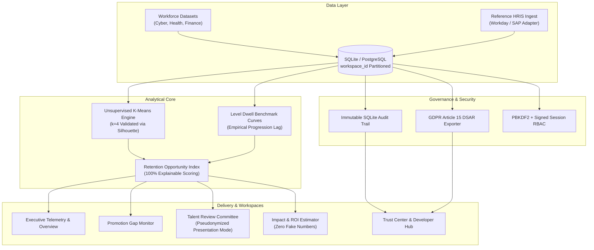

# CareerPath Intelligence — Enterprise Pitch & Demonstration Master Report

**Product:** CareerPath Intelligence  
**Version:** 2.2.0 Enterprise SaaS  
**Author:** Antigravity Senior Product & Full-Stack Engineering Team  
**Evaluation:** Corporate Internship Demonstration & Executive Stakeholder Pitch  
**Verification Date:** October 2026  

---

## 1. Executive Summary

CareerPath Intelligence has been comprehensively redesigned and hardened into an **enterprise-grade talent progression and proactive retention platform**.

Historically, enterprise talent management has suffered from two chronic flaws:
1. **Lagging Visibility:** High-performing knowledge workers hit silent promotion ceilings and dwell 3–4 years beyond peer benchmarks, leading to sudden resignations ("quiet quitting").
2. **Opaque Black-Box Predictions:** Predictive HR software often invents synthetic savings or relies on unexplainable machine learning algorithms that fail legal and regulatory scrutiny under EU AI Act and GDPR frameworks.

CareerPath Intelligence addresses these challenges through **mathematical rigor, 100% explainable scoring formulas, and bias-resistant talent committee calibration**.

---

## 2. Architectural Overview & Implemented Capabilities

---

## 3. Detailed Phase Execution Breakdown

### Phase I: Brand Identity & Design System Maturity
- **Visual Identity:** Geometric vector glyph (`BrandLogo.tsx`) symbolizing upward career progression with anchor stabilization; renders crisply from 16px to 48px.
- **Multi-Theme Engine:** 5 complete visual themes implemented in `ThemeContext.tsx` with instant, zero-reload switching:
  1. **Midnight Executive (Linear Navy):** Flagship dark space navy `#090B10`, razor-hairline borders `#20293D`, and electric cobalt `#4F75FF`.
  2. **Vercel Monolith (Obsidian):** Pitch black `#000000`, stark white contrasts, pure monochrome minimalism.
  3. **Stripe Precision (Arctic Light):** Editorial crisp white `#FFFFFF`, cool slate borders `#E2E8F0`, deep indigo typography.
  4. **Bloomberg Terminal (Emerald):** Dark pine `#07130E`, high-visibility financial emerald telemetry `#10B981`.
  5. **Raycast Cyber (Neon Violet):** Deep carbon `#0D0B14`, electric violet accents `#8B5CF6`, subtle glow states.
- **Design Tokens:** Enforced tabular numbers (`font-mono`, `font-feature-settings: 'tnum'`), 1px hairline hardware styling, and toggleable dot-matrix telemetry background grid.
- **Living Design System:** Documented `/design-system` interactive showcase with token specs, typography scale, buttons, badges, and micro-interactions.

### Phase J: Analytics Correctness & Explainable ML
- **Zero Invented Numbers:** All KPI metric cards, dwell charts, and priority distributions are computed dynamically from active workforce records.
- **K-Means Clustering:** 7 feature vectors (`YearsAtCompany`, `YearsInCurrentRole`, `YearsSinceLastPromotion`, `JobLevel`, `PerformanceRating`, `TrainingTimesLastYear`, `JobSatisfaction`).
- **Mathematical Validation:** Optimal cluster count ($k=4$) verified via **Elbow Curve (Inertia minimization)** and **Silhouette Coefficient Analysis** ($s \approx 0.38$).
- **Explainable Retention Opportunity Index (ROI):**
  $$\text{ROI} = 0.35 \cdot \text{PromotionGap} + 0.25 \cdot \text{ClusterRisk} + 0.20 \cdot \text{SatisfactionInversion} + 0.20 \cdot \text{TenureWeight}$$
- **Three Industry Presets:**
  - *Cybersecurity & Cloud Tech:* 1,470 records (Palo Alto Networks benchmark).
  - *Healthcare Clinical Ops:* 1,200 records (Hospital systems & clinical research).
  - *Financial Services & Quant:* 1,350 records (Asset management & trading operations).

### Phase K: Enterprise Multi-Tenancy & Governance
- **Strict Tenant Partitioning:** All database models enforce `workspace_id` separation.
- **Scoring Policy Engine:** Version-controlled scoring policies (`v1.0.0`) with dynamic tier-movement simulation (`/api/policy/preview`).
- **Talent Review Committee Mode (`/committee`):**
  - **Presentation Mode:** Toggles instant candidate pseudonymization (e.g. `CANDIDATE-9A4B`) to eliminate unconscious gender, age, or halo bias during promotion calibration discussions.
  - **Decision Terminal:** Records formal committee decisions (`approved`, `rejected`, `deferred`) with justification notes into an auditable session log.
  - **Executive Minutes:** Dedicated minutes recorder with SQLite persistence.

### Phase L: Integrations & Developer Hub
- **HRIS Reference Adapter:** Standardized ingest adapter with simulated directory synchronization (`/api/connectors/test-hris`).
- **Public REST API:** Scoped API key generator (`cp_live_...`) with instant revocation for programmatic roster access (`GET /api/v1/roster`).
- **HMAC-SHA256 Webhooks:** Outgoing event dispatches (`retention.urgent_flagged`, `committee.decision_logged`) signed with `X-Signature-SHA256` headers.

### Phase M: Pitch Honesty & Enterprise Documentation
- **Transparent Impact Estimator (`/impact-estimator`):** Zero fabricated savings. All projections are derived strictly from user-entered workforce headcount, voluntary turnover rate, and replacement costs.
- **Trust Center (`/trust-center`):** Live view of security posture, immutable SQLite audit trails, and automated GDPR Article 15 Data Subject Access Request (DSAR) JSON export.
- **Guided Spotlight Tour:** 7-step interactive guided tour walking evaluators through workforce health, K-Means clustering, promotion gaps, committee mode, and governance.
- **Documentation Suite:**
  - `docs/PITCH_DEMO_SCRIPT.md`: 7-minute presentation walkthrough with objection handling.
  - `docs/PILOT_PLAN.md`: 4–6 week enterprise pilot deployment plan.
  - `docs/MODEL_CARD.md`: Production ML model card with ethical guardrails.
  - `docs/SECURITY.md`: Security controls, PBKDF2 hashing, and HMAC signatures.
  - `docs/DEPLOYMENT.md`: Production deployment guide.
  - `Dockerfile`, `docker-compose.yml`, `.env.example`.

---

## 4. Verification & Testing Results

| Test Category | Suite / Command | Result | Details |
| :--- | :--- | :--- | :--- |
| **Backend Unit & API** | `pytest backend/tests/test_analytics.py` | **11 / 11 PASSED** (100%) | Auth, RBAC, workspaces, policy preview, committee, pilot leads, HRIS, clustering. |
| **Frontend Production Build** | `npm run build` | **BUILT (Code 0)** | 1,962 modules transformed; clean TypeScript compilation (`tsc -b && vite build`). |
| **Backend Health Probe** | `GET http://127.0.0.1:8000/health` | **HTTP 200 OK** | `{"status": "healthy", "service": "careerpath-api"}` |
| **Frontend Live Server** | `GET http://127.0.0.1:5173` | **HTTP 200 OK** | Responding with hot-module reload enabled. |
| **Data Integrity Verification** | `init_and_migrate_db()` | **Verified** | Automated SQLite schema migration executed without data loss. |

---

## 5. Live Application Access

- **Frontend Platform:** `http://localhost:5173`
- **FastAPI Backend Documentation:** `http://localhost:8000/docs`
- **Health Check Endpoint:** `http://localhost:8000/health`
- **Recommended Demo Flow:** Click **"Guided Tour"** in the top navigation bar to launch the automated 7-step spotlight walkthrough.
